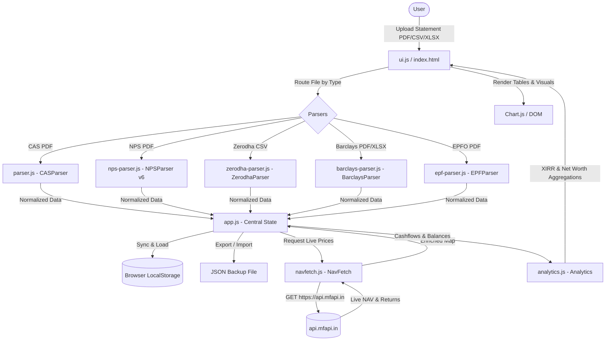

# Architecture — FolioSense

## System Overview

FolioSense is a client-side Single Page Application (SPA) designed for multi-asset personal wealth tracking and retirement planning. It executes 100% inside the client's browser, eliminating server-side storage and data transmission of private financial statements.



---

## Frontend Architecture

- **UI Shell**: Multi-screen tabbed interface in [`index.html`](file:///home/anisha/Desktop/Sandeep/PortfolioManagement/index.html) controlled via screen IDs:
  - `overview`: Portfolio net worth summary, asset allocation cards, goals summary, top holdings.
  - `goals`: Financial goal mapping, target values, completion progress, scheme assignment.
  - `mf`: Mutual fund portfolio tables, folio breakdowns, XIRR, 1Y/3Y benchmark returns, AMFI live values.
  - `stocks-in`: Indian stock holdings parsed from Zerodha Kite CSV exports.
  - `stocks-fn`: Foreign equity grants (Barclays ESOP/SVP) from PDF/Excel statements.
  - `savings`: Bank accounts, Fixed Deposits (FD), and Recurring Deposits (RD) with manual entries.
  - `nps`: National Pension System summary and scheme holdings.
  - `nsc`: National Savings Certificate holdings.
  - `epf`: EPFO passbook details, employee/employer contributions, and pension balances.
- **Styling**: Pure CSS in [`style.css`](file:///home/anisha/Desktop/Sandeep/PortfolioManagement/style.css) with CSS custom properties (`--bg`, `--card`, `--green`, `--text`, etc.) supporting instant Dark/Light mode switching via `[data-theme='light']`.
- **Chart Visualizations**: Rendered using Chart.js onto HTML5 `<canvas>` elements.

---

## Backend & Persistence Architecture

- **Backend**: None. There is no server-side application layer.
- **Storage**: Browser `localStorage` acts as the persistent store.
  - Primary Key: `foliosense_state` (JSON string serialized with date reviving).
  - Synchronized Legacy Keys:
    - `folio_savings`: Bank savings, FDs, and RDs.
    - `folio_foreign`: Barclays equity grants.
    - `folio_nsc`: NSC records.
    - `folio_epf`: EPF balances.
    - `foliosense_goals_meta`: Goal targets, deadlines.
    - `foliosense_goals`: Asset-to-goal associations.
    - `folio_fund_returns`: Cached 1Y/3Y returns.
- **Backup**:
  - `Export Backup`: Generates a downloadable JSON file containing all portfolio and goals state.
  - `Import Backup`: Restores complete state from a previously exported JSON backup.

---

## State Schema (`app.js`)

```javascript
state = {
  portfolios:       [], // Array of parsed Mutual Fund CAS portfolios (per person)
  npsPortfolios:    [], // Array of parsed NPS statements
  stocksPortfolios: [], // Deduplicated Indian stock holdings portfolios
  savings: {
    accounts:       [], // { bankName, accNumber, balance }
    fds:            [], // { bankName, principal, maturityDate, rate, maturityVal }
    rds:            []  // { bankName, monthlyDeposit, maturityDate, rate, maturityVal }
  },
  foreignEquities: {
    barclays: { grants: [] } // { grantDate, qty, strikePrice, vestDate, status }
  },
  nsc:              [], // NSC investment records
  epf:              [], // Parsed EPF passbook records
  liveNavMap:       {}, // amfiCode -> { nav, date, schemeName }
  activePerson:   null, // Filter: null = "All", or person name string
  goalsMetadata:    {}, // goalName -> { targetAmount, targetDate }
  goals:            {}, // holdingKey -> goalName
  fundReturnsMap:   {}, // amfiCode -> { oneYear, threeYear }
  isDirtySinceExport: false
}
```

---

## API Layer & External Integrations

- **Endpoint**: `https://api.mfapi.in/mf/<amfiCode>/latest`
- **Fallback Search**: `https://api.mfapi.in/mf/search?q=<isin>` (for demat CAS lacking AMFI code).
- **Historical Returns**: `https://api.mfapi.in/mf/<amfiCode>` (batches of 3 concurrent requests to avoid rate limits).
- **In-Memory Caching**: `navCache` and `searchCache` in `navfetch.js` minimize redundant network requests during session runtime.

---

## Authentication & Security

- **User Authentication**: None required (local single-user application).
- **PDF Password Handling**:
  - Password prompt displayed via modal dialog (`#password-modal`).
  - Stored only in ephemeral JavaScript promise resolution closure (`_pwResolve`) during PDF.js decryption.
  - Never written to `localStorage`, never logged, and never transmitted across the network.

---

## Major Modules & Namespaces

| File | Global Namespace | Primary Responsibility |
|------|-----------------|------------------------|
| `js/app.js` | `window._FolioSense` | Application bootstrap, state management, save/load, event coordination |
| `js/ui.js` | `window.UI` | DOM rendering, modal handling, toast notifications, formatters, screen routing |
| `js/analytics.js` | `window.Analytics` | Newton-Raphson XIRR algorithm, portfolio metric calculations, returns |
| `js/navfetch.js` | `window.NavFetch` | HTTP client for `api.mfapi.in` with caching and rate-limiting |
| `js/parser.js` | `window.CASParser` | PDF text extraction and regex parser for CAMS/KFintech CAS statements |
| `js/nps-parser.js` | `window.NPSParser` | Extraction of NPS Tier-1 and scheme balances directly from statement text |
| `js/zerodha-parser.js` | `window.ZerodhaParser` | Parsing and header normalization of Zerodha Kite holdings CSV files |
| `js/barclays-parser.js` | `window.BarclaysParser` | Parsing Barclays ESOP / SVP award statements (PDF & SheetJS Excel) |
| `js/epf-parser.js` | `window.EPFParser` | EPFO Passbook PDF text extraction and contribution categorization |

---

## Deployment Architecture

- Statically served via any HTTP file server (e.g., `serve`, NGINX, GitHub Pages, or local browser execution).
- Zero server dependencies.
